<p align="center">
  
</p>

<p align="center">
  
  
  
  
  
</p>

<p align="center">
  <i>Боевой слой сервера «РАСКОЛ | ДВЕ КОРОНЫ»: шесть путей, две короны, одна война.</i>
</p>

<p align="center">
  <a href="#две-короны">Две короны</a> ·
  <a href="#классы-и-традиции">Классы</a> ·
  <a href="#деревья-путей">Деревья путей</a> ·
  <a href="#боевые-системы">Боевые системы</a> ·
  <a href="#архитектура">Архитектура</a> ·
  <a href="#команды">Команды</a> ·
  <a href="#установка">Установка</a>
</p>

<table align="center">
  <tr>
    <td align="center"><b>6</b><br/><sub>классов</sub></td>
    <td align="center"><b>18</b><br/><sub>специализаций</sub></td>
    <td align="center"><b>8</b><br/><sub>школ урона</sub></td>
    <td align="center"><b>9</b><br/><sub>типов контроля</sub></td>
    <td align="center"><b>5</b><br/><sub>видов DoT</sub></td>
    <td align="center"><b>120</b><br/><sub>headless-чеков</sub></td>
  </tr>
</table>

## Две короны

| Корона | Цвет и аура | Природа |
| --- | --- | --- |
| **Рассвет** | золото · `END_ROD` | Свет, порядок, клятва |
| **Вальрадис** | багрянец · `SOUL_FIRE_FLAME` | Дракон, пепел, долг |

## Классы и традиции

| Класс | Традиция | Ресурс | Атрибут | Роль |
| --- | --- | --- | :-: | --- |
| **Воин** | Нордика | Ярость, −5/с вне боя | STR | Передовая линия, execute-финишеры |
| **Охотник** | Путь ведьмака | Концентрация, +5/с вне боя | AGI | Дистанция, метки, ловушки |
| **Жрец** | Католика | Свет, +2/с всегда | INT | Лечение, щиты, кары, очищение |
| **Маг** | Эллада | Мана, тиры по порогам | INT | Бурст, зоны, горение и охлаждение |
| **Разбойник** | Ночные гильдии | Энергия, +10/с | AGI | Скрытность, яды, спина |
| **Чернокнижник** | Фолиант Душ (скрытый) | Скверна, событийная | INT | Дрейн, диспел, анти-хил, DoT |

## Деревья путей

С 15 уровня каждый класс открывает **3 специализации** с деревом прогрессии (Спек 2.0): 20–21 узел, 6 рядов. Бюджет очков за карьеру — **46** (15→60, +1 за уровень). Старт, бюджет и гейты читаются из `spec2.start-level`, `spec2.max-points` и `spec2.row-gates`.

Ёмкость дерева не меньше бюджета, поэтому закрыть дерево целиком нельзя: выбор ветки остаётся осознанным билдом. Нижнюю границу контролируют `spec2.tree-capacity-min` и чек 93 selftest.

**Гейты рядов** считаются по очкам, вложенным внутрь самого дерева:

| Ряд | 1 | 2 | 3 | 4 | 5 | 6 (ульт) |
| --- | :-: | :-: | :-: | :-: | :-: | :-: |
| Очков в дереве | 0 | 5 | 10 | 15 | 20 | 30 |

| Класс | Специализации и роли |
| --- | --- |
| Воин | Оружие `F` · Неистовство `F` · Защита `T` |
| Охотник | Стрельба `F` · Выживание `F` · Повелитель зверей `F` |
| Жрец | Послушание `H` · Свет `H` · Тьма `F` |
| Маг | Тайная магия `F` · Огонь `F` · Лёд `F` |
| Разбойник | Ликвидация `F` · Головорез `F` · Скрытность `F` |
| Чернокнижник | Колдовство `F` · Разрушение `F` · Демонология `F` |

| Роль | Эффект |
| --- | --- |
| `F` FIGHTER | +2% урона |
| `T` TANK | +5% ccResist и +5% получаемого лечения |
| `H` HEALER | +5% исходящего лечения |

**Типы узлов:** `passive_stat` · `passive_proc` · `unlock_ability` · `enhance_ability` · `ultimate` (ряд 6, 1/1). Ранги 1–5, стоимость ранга — 1 очко в любом из 3 деревьев класса, пререквизиты ранговые. Узлы `resist` принимают таргет-школу (`nature`, `fire`, …) и дают стихийный резист.

### Управление

1. `/rc menu` → **Специализации**: выбор основной спеки (один раз, бесплатно, с 15 уровня).
2. **Деревья путей**: ЛКМ по узлу даёт +1 ранг.
3. ПКМ по купленному узлу — респец одного ранга: взвод 30 с, затем подтверждение. Цена: `spec2.node-respec-base` + `spec2.node-respec-per-rank` × ранг.
4. Кристалл — платный сброс **всего** дерева с возвратом очков в общий пул.

Вкладка листает ряды ◀ ▶ и переключает спеки класса (main + 2 secondary).

## Боевые системы

<details>
<summary><b>Здоровье</b></summary>

HP = `base-hp` + STR × `per-str` + level × `per-level` + (STR-main ? level × `main-str-bonus` : 0) + `gear-hp`, далее × (1 + `hp_pct`/100) из узлов.

| Механика | Описание |
| --- | --- |
| **План B** | carrier ≤ 1024 (ванильный `max_health`), formula без потолка, scale = carrier / formula |
| **HpPool** | Единые точки входа `healFormula`, `currentFormulaHp`, `targetCarrier` |
| **Защита от бурста** | Окно 3 с ≤ 18%, анти-ваншот ≤ 35%, LOS для площадей, летальность среды |
| **Восстановление на входе** | `pendingRestore`: ratio из `health.yml` применяется после загрузки класса LuckPerms, релог в первые секунды не портит сохранённое HP |
| **Отложенная запись** · 1.14.7 | `saveHealth()` пишет в память, на диск данные сбрасываются периодически (`storage.health-flush-seconds`, по умолчанию 60 с): один проход вместо N записей файла |

Ориентиры максимального HP:

| Класс | L40 | L60 |
| --- | --: | --: |
| Воин | ≈ 1780 | ≈ 2560 |
| Маг / Жрец / Чернокнижник | ≈ 700 | ≈ 840 |

</details>

<details>
<summary><b>Школы урона</b> · 1.12.x</summary>

8 школ (`PHYSICAL`, `FIRE`, `FROST`, `NATURE`, `SHADOW`, `HOLY`, `ARCANE`, `TRUE`) сворачиваются в 3 канала защиты.

Порядок митигации:

| Шаг | Этап | Предел |
| :-: | --- | --- |
| 1 | Канал защиты (3 канала) | — |
| 2 | Резист канала | — |
| 3 | Пробитие, flat → pct | кап 40% |
| 4 | Стихийный резист | кап 60% |
| 5 | Поглощение | кап 90% |

Иммунитеты и уязвимости мобов, множители школ, маппинг ванильных причин урона на школы.

</details>

<details>
<summary><b>DoT-ядро</b> · 1.12.4–1.14.0</summary>

Реестр `dots.*`:

| DoT | Школа |
| --- | --- |
| `burning` | FIRE |
| `poison` | NATURE |
| `bleed` | PHYSICAL |
| `chilled` | FROST |
| `wither` | SHADOW |

Стеки, атрибуция владельца, кап суммарного DoT-DPS 6% formula-maxHP. Средовые триггеры: вода и пушистый снег гасят огонь, огонь и лава плавят лёд. Очищение жреца снимает NATURE + SHADOW. DoT-строка в HUD.

</details>

<details>
<summary><b>Контроль и убывающая отдача</b> · 1.13.0</summary>

9 типов CC, 6 категорий DR. Окно 15 с, множители `[1.0, 0.5, 0.25, 0.0]`: четвёртый CC в окне даёт иммунитет.

- `ccResist` / `ccPower` / `ccReduction`: класс + Скверна + узлы деревьев + роль TANK.
- Гейт каста, прерывание каналов (`CastChannels`), обёртка ванильных зелий через DR, `breaksOnDamage` для ROOT/FEAR.
- Визуал: голограмма `TextDisplay` над целью.

</details>

<details>
<summary><b>Проки</b> · 1.14.3–1.14.6</summary>

`combat/ProcService` — единый фасад proc-узлов.

**Контракт единиц.** Значение узла — доля шанса за ранг (0.15 = 15%), бросок выполняется при событии. Сила эффекта берётся из `spec2.procs.<id>.amp`: riposte +50%, revenge +10%, headshot ×2, second_wind 8% HP, reflect_magic 20% и т. д.

Amplifier следующего удара ставится на защищавшегося (parry, dodge, block).

</details>

<details>
<summary><b>Пет-система</b> · 1.14.6</summary>

`pet/PetService` + `PetDef` + `PetMath`:

| Пет | Владелец | Время жизни | Масштаб |
| --- | --- | --- | --- |
| `wolf` | Охотник | постоянный | STR / WP |
| `demon` | Чернокнижник | 12 с | INT / SP |
| `shadowfiend` | Жрец | 8 с | INT / SP |

| Правило | Описание |
| --- | --- |
| **Масштаб** | hp = base + attr × 2, dmg = base + power × 0.3, далее × узлы `pet_hp_pct` / `pet_dmg_pct` |
| **Жизненный цикл** | 1 пет на владельца, следование 12 блоков, дезспавн на смерть и выход |
| **Бой** | Гейты `canHit`, ретаргет на цель владельца |
| **Баффы** | `beast_ferocity`, `bestial_wrath`; ульт-поглощение `demon_soul` |

</details>

<details>
<summary><b>Лечение и роли</b> · 1.14.7</summary>

Единый путь лечения идёт через `CustomHealEvent`. Статический маркер `healerMark` удалён: атрибуция целителя живёт в `CustomHealEvent.getHealer()`.

| Множитель | Источник |
| --- | --- |
| `heal_out_pct` | Узлы деревьев (исходящее лечение) |
| HEALER | Роль, +5% исходящего лечения (`Spec2RoleListener`) |
| `heal_received_pct` | Узлы деревьев (получаемое лечение) |
| TANK | Роль, +5% получаемого лечения (`Spec2RoleListener`) |

</details>

<details>
<summary><b>Шкала ресурса</b> · 1.14.7</summary>

Шкала ресурса в unified-actionbar нормируется на `ResourceState.getEffectiveMax()`, а не на константу 100. Узлы `resource_max` и `setCeiling` из spec2 растягивают бар для потолка выше 100. Текст рядом показывает `res/effectiveMax`.

</details>

## Архитектура

Модули линии 1.14.7:

| Слой | Структура |
| --- | --- |
| Способности | `ability/*Abilities` (6 китов) + `WarlockMath` / `WarlockFx` (pure и визуал) |
| Пассивки | `ability/passive/ClassPassive` + 6 файлов по классам; `PassiveListener` — диспетчер |
| Инсталляции | `install/InstallationHandler` + 6 обработчиков; `InstallationService` — реестр |
| Бой | `CombatService` (фасад) + `VanillaDamageListener` + `DamageCaps` + `CombatMath` (pure) |
| Школы | `combat/school/*`: `School`, `SchoolProfile`, `SchoolConfig`, `SchoolMitigation`, `SchoolImmunity` |
| Пробитие и резисты | `PenTraitsService`, `ElementalResistService` |
| DoT | `combat/dot/*`: `DotDef`, `DotInstance`, `DotMath` (pure), `DotService` |
| Контроль: ядро | `cc/*`: `CCType`, `DRCategory`, `DRState`, `CCInstance`, `CCService` |
| Контроль: защита и каналы | `CCGuard`, `CastGuard`, `CastChannels`, `CCFeedback`, `VanillaCCWrapper` |
| Контроль: команды и проверки | `CcSub`, `CcSanity` |
| Проки | `combat/ProcService`: amplifier, expose, undodgeable, stealth-состояния, crit-mult, dot-extend, vendetta refresh |
| Лечение | `event/CustomHealEvent` + `Spec2RoleListener` (композиция heal_out, HEALER, heal_received, TANK) |
| Петы | `pet/*`: `PetDef`, `PetMath` (pure), `PetService` (жизненный цикл, баффы, гейты) |
| Спек 2.0: модель | `spec/*`: `Spec` (18), `SpecRole`, `SpecRoles`; `spec/model/*` |
| Спек 2.0: реестр | `spec/registry/trees/*Trees` (18 деревьев) |
| Спек 2.0: хранилище | `spec/storage/Spec2Storage` (`spec2-storage.yml`, миграция из `spec2.yml`) |
| Спек 2.0: сервис | `spec/service/Spec2Service` + `Spec2EffectsApplier`; `spec/listen/Spec2RoleListener` |
| Атрибуты | `AttributeService` (фасад) + `HpPool` (план B) + `AttributeModifiers` |
| HUD | `HpBarService` (HP и ресурс, отложенная запись `health.yml`) + `HudService` (DoT-строка, dirty-rendering) |
| Книга | `ClassBook` (фасад) + `gui/book/*Tab` (5 вкладок: пагинация рядов, переключатель спек, ПКМ-респец узла) |
| Команды | `RaskolCommand` (роутер) + `command/sub/*Sub` (debug, gear, foliant, health, cc) |
| Конфиг | `config.yml` (avoidance и hp-display в корне с 1.14.6-fix) + per-class `kits/<class>.yml` |
| Тесты | `/rc selftest` — **120 headless-чеков** |

## Команды

| Команда | Права | Описание |
| --- | --- | --- |
| `/rc` | — | Сводка игрока |
| `/rc menu` | `raskolclasses.menu` | Книга класса (5 вкладок) |
| `/rc gear [player]` | `raskolclasses.debug` | Экипировка, статы шмота, сеты N/4 |
| `/rc debug [player]` | `raskolclasses.debug` | Атрибуты, резисты, pen, стихии, CC/DR, очки путей |
| `/rc debug simulate …` | `raskolclasses.debug` | Дуэль и матрица TTK 6×6 |
| `/rc health` | `raskolclasses.debug` | MSPT/TPS, purge, аптайм, per-class конфиги |
| `/rc selftest` | `raskolclasses.debug` | 120 headless-чеков |
| `/rc cc list\|status\|clear\|test\|reset` | `raskolclasses.admin.cc` | Админка контроля с DR |
| `/rc foliant give <ник>` | `raskolclasses.admin` | Выдать Фолиант Душ |
| `/rc reload` | `raskolclasses.admin` | Перезагрузка `config.yml` + `kits/*.yml` |

## Плейсхолдеры

```text
%raskolclasses_class%         %raskolclasses_level%         %raskolclasses_hp%
%raskolclasses_hp_max%        %raskolclasses_resource%      %raskolclasses_phys_resist%
%raskolclasses_magic_resist%  %raskolclasses_dodge%         %raskolclasses_parry%
%raskolclasses_crit_melee%    %raskolclasses_crit_spell%    %raskolclasses_spec%
%raskolclasses_talent_points% %raskolclasses_talents%       %raskolcrown_*%
```

`spec`, `talent_points` и `talents` читают spec2-слой: основная спека, доступные очки, потрачено и заработано.

## RaskolGear

| Что | Применяет в бою | Считает и показывает |
| --- | --- | --- |
| Урон оружия, крит, проки | RaskolGear | — |
| Резисты шмота, сет-бонусы 4/4 | RaskolGear | RaskolClasses: `/rc gear`, Книга |
| pen-трейты шмота (1.12.2) | RaskolClasses (`PenTraitsService`) | `/rc debug`, Книга |
| `+HP` шмота | RaskolClasses (`HpPool`) | HUD, `/rc debug` |
| Классовые и спек-резисты | RaskolClasses | `ResistService` + spec2-агрегат |
| Burst и single-hit cap | RaskolClasses | `DamageCaps` |

WARLOCK-сеты добавляются секциями `weapons.WARLOCK.*` и `armor.WARLOCK.*` в конфиг RaskolGear.

## Установка

```bash
mvn -B clean package
cp target/raskol-classes-1.14.7.jar plugins/
# перезапуск сервера
/rc selftest   # ожидается 120/120 PASS
```

> [!NOTE]
> При первом старте 1.14.4+ выполняется миграция хранилища: `spec2.yml` → `spec2-storage.yml` (rename, содержимое не меняется). В логе появится строка `spec2: migrated …`.

**Softdepend:** `LuckPerms` · `AuraSkills` · `PlaceholderAPI` · `RaskolCore` · `Towny` · `Vault` · `RaskolGear` · `AuthMe` · `Essentials` · `packetevents`. Каждый опционален, деградация graceful.

<details>
<summary><b>Регресс-матрица selftest</b> · 120 чеков</summary>

| Область | Чеки |
| --- | :-: |
| Атрибуты и бой | 1–21 |
| spec2-экономика | 22–24 |
| Ресурсы, план B | 29–36 |
| Чернокнижник, `WarlockMath`, sanity | 37–48 |
| Школы | 49–65 |
| DoT, баланс | 66–75 |
| CC / DR | 76–90 |
| spec2-модель | 91–94 |
| Переносимые slots 4–5 | 95–98 |
| unlock-покрытие | 99 |
| heal, паверы, ресурс, проки, боевые pct | 100–104 |
| resist-школа, `resetNode`, конфиг-точки | 105–107 |
| Пет-ядро | 108–112 |
| spec2.procs (полная) | 113 |
| kit_dur, attack_speed, контракт C | 114–116 |
| HAS_DEPENDENTS, антиспам-метка | 117–118 |
| Отложенная запись HP, effectiveMax | 119–120 |

Полный прогон — перед любым хотфиксом и релизом. Skip-чеки считаются отдельно и не входят в PASS-счётчик (с sprint 1).

</details>

## Документация

| Файл | Содержание |
| --- | --- |
| [`RUNBOOK.md`](RUNBOOK.md) | Аварии, гейты, тюнинг без пересборки, операторские заметки |
| [`docs/RUNBOOK.md`](docs/RUNBOOK.md) | Контроль и DR, проки, респецы, миграции: конфиг-карта, команды, troubleshooting |
| [`CHANGELOG.md`](CHANGELOG.md) | История версий (не переписывается задним числом) |
| [`LICENSE`](LICENSE) | RASKOL Proprietary License v1.0 |

<p align="center">
  <sub>© 2026 hayferdahmer · RASKOL Proprietary License v1.0<br/>использование только на сервере «РАСКОЛ | ДВЕ КОРОНЫ»</sub>
</p>
