<!--
  Если ты читаешь исходник этого файла — значит, ты из своих.
  Пирог на столе, чай ещё горячий. Присаживайся.
-->

<p align="center">
  <picture>
    <source media="(prefers-color-scheme: dark)" srcset="banner-dark.svg"/>
    <source media="(prefers-color-scheme: light)" srcset="banner-light.svg"/>
    
  </picture>
</p>

<p align="center">
  <a href="https://github.com/hayferdahmer/RaskolClasses/actions/workflows/build.yml"></a>
  <a href="CHANGELOG.md"></a>
  <a href="#install"></a>
  
  <br/>
  
  
  <a href="https://github.com/hayferdahmer/RaskolClasses/commits/main"></a>
  <a href="LICENSE"></a>
</p>

<p align="center">
  <i>«Присядь к огню, путник. За окном — две короны и одна война,<br/>
  а здесь — шесть дорог, три тропы на каждую и тёплый свет из окон.»</i>
</p>

<p align="center">
  <b>⚜ &nbsp;Боевой слой сервера «РАСКОЛ | ДВЕ КОРОНЫ»&nbsp; ⚜</b><br/>
  <sub>шесть путей · две короны · одна война</sub>
</p>

<br/>

<p align="center">
  <b>🕯 Оглавление свитка 🕯</b><br/>
  <a href="#crowns">I · Две короны</a> ·
  <a href="#paths">II · Шесть путей</a> ·
  <a href="#trees">III · Деревья путей</a> ·
  <a href="#combat">IV · Боевые системы</a><br/>
  <a href="#plus">V · raskolspec+</a> ·
  <a href="#architecture">VI · Устройство замка</a> ·
  <a href="#commands">VII · Заклинания</a> ·
  <a href="#placeholders">VIII · Руны</a><br/>
  <a href="#items">IX · Кузница</a> ·
  <a href="#install">X · Очаг</a> ·
  <a href="#docs">XI · Библиотека</a>
</p>

<br/>

<table align="center">
  <tr>
    <td align="center" width="120"><b>6</b><br/><sub>классов</sub></td>
    <td align="center" width="120"><b>18</b><br/><sub>специализаций</sub></td>
    <td align="center" width="120"><b>8</b><br/><sub>школ урона</sub></td>
    <td align="center" width="120"><b>9</b><br/><sub>типов контроля</sub></td>
    <td align="center" width="120"><b>5</b><br/><sub>видов DoT</sub></td>
    <td align="center" width="120"><b>167</b><br/><sub>headless-чеков</sub></td>
  </tr>
</table>

<br/>

> **RaskolClasses** — боевой слой Paper-сервера: шесть классов с собственными ресурсами, три специализации на класс с деревьями Спек 2.0, восемь школ урона с пятиступенчатой митигацией, контроль с убывающей отдачей, DoT-ядро, проки, петы и каталог из 342 предметов с сетами.
>
> Ниже — правила боя, конфигурация и операторские команды; сборка и проверка — в главе X «Очаг».

### 🔥 У очага: быстрый старт

**Для боевого сервера:** установите официальный JAR из [GitHub Releases](https://github.com/hayferdahmer/RaskolClasses/releases), затем перезапустите Paper и проверьте в журнале `[RIPS] INFO | VERIFIED`.

**Для локальной разработки:** соберите DEVELOPMENT-артефакт и запускайте его только в изолированной тестовой среде:

```bash
mvn -B clean verify
# DEVELOPMENT JAR: target/raskol-classes-1.15.8.jar
# для локального тестирования требуется JVM-флаг:
# -Draskol.rips.development=true
```

После запуска выполните `/rc selftest`: ожидается **167/167 PASS**. Не устанавливайте обычный Maven JAR на production-сервер.

<p align="center"></p>

<br/>

<a id="crowns"></a>

## ⚜ Глава I · Две короны

<sub><i>Золото и порядок против багрянца и пепла. Короны задают тон серверу.</i></sub>

<br/>

<table align="center">
  <tr>
    <td align="center" width="260"><br/><b>Рассвет</b><br/><sub>золото · свет · клятва</sub></td>
    <td align="center" width="260"><br/><b>Вальрадис</b><br/><sub>багрянец · пепел · долг</sub></td>
  </tr>
</table>

<br/>

| Корона | Цвет | Аура | Природа |
| --- | --- | :-: | --- |
| ☀️ **Рассвет** | золото | `END_ROD` | Свет, порядок, клятва |
| 🐉 **Вальрадис** | багрянец | `SOUL_FIRE_FLAME` | Дракон, пепел, долг |

<br/>

<a id="paths"></a>

## ⚜ Глава II · Шесть путей

<sub><i>У каждого пути — своя традиция, свой ресурс и свой главный атрибут.</i></sub>

<br/>

<table align="center">
  <tr>
    <td align="center" width="200"><br/><b>Воин</b><br/><sub>Нордика</sub></td>
    <td align="center" width="200"><br/><b>Охотник</b><br/><sub>Путь ведьмака</sub></td>
    <td align="center" width="200"><br/><b>Жрец</b><br/><sub>Католика</sub></td>
  </tr>
  <tr>
    <td align="center" width="200"><br/><b>Маг</b><br/><sub>Эллада</sub></td>
    <td align="center" width="200"><br/><b>Разбойник</b><br/><sub>Ночные гильдии</sub></td>
    <td align="center" width="200"><br/><b>Чернокнижник</b><br/><sub>Фолиант Душ · скрытый</sub></td>
  </tr>
</table>

<br/>

| Класс | Традиция | Ресурс | Атрибут | Роль |
| --- | --- | --- | :-: | --- |
| ⚔️ **Воин** | Нордика | Ярость · −5/с вне боя | `STR` | Передовая линия, execute-финишеры |
| 🏹 **Охотник** | Путь ведьмака | Концентрация · +5/с вне боя | `AGI` | Дистанция, метки, ловушки |
| 🕯️ **Жрец** | Католика | Свет · +2/с всегда | `INT` | Лечение, щиты, кары, очищение |
| 🔮 **Маг** | Эллада | Мана · тиры по порогам | `INT` | Бурст, зоны, горение и охлаждение |
| 🗡️ **Разбойник** | Ночные гильдии | Энергия · +10/с | `AGI` | Скрытность, яды, спина |
| 📕 **Чернокнижник** | Фолиант Душ · скрытый | Скверна · событийная | `INT` | Дрейн, диспел, анти-хил, DoT |

<br/>

<a id="trees"></a>

## ⚜ Глава III · Деревья путей

<sub><i>С 15 уровня каждая дорога расходится на три тропы. Выбирай внимательно: все сразу не пройти.</i></sub>

<br/>

С 15 уровня каждый класс открывает **три специализации** с деревом прогрессии (Спек 2.0): 20–21 узел, шесть рядов. Бюджет очков за карьеру — **46** (15 → 60, +1 за уровень). Старт, бюджет и гейты читаются из `spec2.start-level`, `spec2.max-points` и `spec2.row-gates`.

Ёмкость дерева не меньше бюджета, поэтому закрыть дерево целиком нельзя: выбор ветки остаётся осознанным билдом. Нижнюю границу контролируют `spec2.tree-capacity-min` и чек 93 в `/rc selftest`.

**Гейты рядов** считаются по очкам, вложенным внутрь самого дерева.

| Ряд | 1 | 2 | 3 | 4 | 5 | 6 · ульт |
| --- | :-: | :-: | :-: | :-: | :-: | :-: |
| Очков в дереве | 0 | 5 | 10 | 15 | 20 | 30 |

**Специализации** — по три на класс. Буква справа — роль тропы.

```text
┌─ Воин
│   ├─ Оружие············· F
│   ├─ Неистовство········ F
│   └─ Защита············· T
├─ Охотник
│   ├─ Стрельба··········· F
│   ├─ Выживание·········· F
│   └─ Повелитель зверей·· F
├─ Жрец
│   ├─ Послушание········· H
│   ├─ Свет··············· H
│   └─ Тьма··············· F
├─ Маг
│   ├─ Тайная магия······· F
│   ├─ Огонь·············· F
│   └─ Лёд················ F
├─ Разбойник
│   ├─ Ликвидация········· F
│   ├─ Головорез·········· F
│   └─ Скрытность········· F
└─ Чернокнижник
    ├─ Колдовство········· F
    ├─ Разрушение········· F
    └─ Демонология········ F
```

**Роли** дают пассивный вклад в группу.

| Роль | Эффект |
| --- | --- |
| `F` FIGHTER | +2% урона |
| `T` TANK | +5% ccResist · +5% получаемого лечения |
| `H` HEALER | +5% исходящего лечения |

**Типы узлов:** `passive_stat` · `passive_proc` · `unlock_ability` · `enhance_ability` · `ultimate` (ряд 6, 1/1). Ранги 1–5, стоимость ранга — 1 очко в любом из трёх деревьев класса, пререквизиты ранговые. Узлы `resist` принимают таргет-школу (`nature`, `fire`, …) и дают стихийный резист.

### 🧭 Как ходить по тропам

1. `/rc menu` → **Специализации**: выбор основной спеки — один раз, бесплатно, с 15 уровня.
2. **Деревья путей**: ЛКМ по узлу даёт +1 ранг.
3. ПКМ по купленному узлу — респец одного ранга: взвод 30 с, затем подтверждение. Цена: `spec2.node-respec-base` + `spec2.node-respec-per-rank` × ранг.
4. Кристалл — платный сброс **всего** дерева с возвратом очков в общий пул.

Вкладка листает ряды ◀ ▶ и переключает спеки класса: основная и две вторичные.

<br/>

<a id="combat"></a>

## ⚜ Глава IV · Боевые системы

<sub><i>Подсистемы ниже складываются в один язык боя. Открывай свитки по одному.</i></sub>

<br/>

<details>
<summary>🫀 <b>Здоровье</b></summary>

<br/>

HP считается от базы, атрибута и уровня; процентные узлы `hp_pct` применяются последними.

```text
HP = base-hp + STR × per-str + level × per-level
   + (STR-main ? level × main-str-bonus : 0)
   + gear-hp
   × (1 + hp_pct / 100)
```

| Механика | Описание |
| --- | --- |
| **План B** | carrier ≤ 1024 (ванильный `max_health`), formula без потолка, scale = carrier / formula |
| **HpPool** | Единые точки входа `healFormula`, `currentFormulaHp`, `targetCarrier` |
| **Защита от бурста** | Окно 3 с ≤ 18%, анти-ваншот ≤ 35%, LOS для площадей, летальность среды |
| **Восстановление на входе** | `pendingRestore`: ratio из `health.yml` применяется после загрузки класса LuckPerms; релог в первые секунды не портит сохранённое HP |
| **Отложенная запись** · 1.14.7 | `saveHealth()` пишет в память, на диск данные сбрасываются периодически (`storage.health-flush-seconds`, по умолчанию 60 с): один проход вместо N записей файла |

**Ориентиры максимального HP.**

| Класс | L40 | L60 |
| --- | --: | --: |
| Воин | ≈ 1780 | ≈ 2560 |
| Маг / Жрец / Чернокнижник | ≈ 700 | ≈ 840 |

</details>

<details>
<summary>🌌 <b>Школы урона</b> · 1.12.x</summary>

<br/>

8 школ (`PHYSICAL`, `FIRE`, `FROST`, `NATURE`, `SHADOW`, `HOLY`, `ARCANE`, `TRUE`) сворачиваются в 3 канала защиты.

**Порядок митигации.**

| Шаг | Этап | Предел |
| :-: | --- | --- |
| 1 | Канал защиты (3 канала) | — |
| 2 | Резист канала | — |
| 3 | Пробитие, flat → pct | кап 40% |
| 4 | Стихийный резист | кап 60% |
| 5 | Поглощение | кап 90% |

Иммунитеты и уязвимости мобов, множители школ, маппинг ванильных причин урона на школы.

</details>

<details>
<summary>🗡️ <b>Владение оружием</b> · 1.15.2</summary>

<br/>

Матрица 8 типов оружия × 6 классов: `×1.00` — родное оружие класса, `×0.75` — знакомое, `×0.50` — чужое. Множитель применяется к PHYSICAL-урону в `applyOutgoingOffense` (после base+add, до stealth/amplifier/crit); MAGIC-канал он не затрагивает.

| Класс | Родное · ×1.00 | Знакомое · ×0.75 | Чужое · ×0.50 |
| --- | --- | --- | --- |
| **Воин** | SWORD · AXE · MACE | DAGGER | BOW · CROSSBOW · STAFF · WAND |
| **Охотник** | BOW · CROSSBOW | DAGGER · AXE | MACE · SWORD · STAFF · WAND |
| **Разбойник** | DAGGER | SWORD | AXE · MACE · BOW · CROSSBOW · STAFF · WAND |
| **Маг** | STAFF · WAND | — | DAGGER · SWORD · AXE · MACE · BOW · CROSSBOW |
| **Жрец** | MACE | STAFF · WAND | DAGGER · SWORD · AXE · BOW · CROSSBOW |
| **Чернокнижник** | WAND | STAFF | DAGGER · SWORD · AXE · MACE · BOW · CROSSBOW |

`/rc debug <ник>` печатает разбор: «Владение оружием: SWORD → NATIVE (×100.0% урона)». Selftest 131–133 проверяют 48 ячеек матрицы, конкретные пары WARRIOR/HUNTER и null-защиту.

</details>

<details>
<summary>🔥 <b>DoT-ядро</b> · 1.12.4–1.14.0</summary>

<br/>

**Реестр `dots.*`.**

| DoT | Школа |
| --- | --- |
| `burning` | FIRE |
| `poison` | NATURE |
| `bleed` | PHYSICAL |
| `chilled` | FROST |
| `wither` | SHADOW |

Стеки, атрибуция владельца, кап суммарного DoT-DPS — 6% formula-maxHP. Средовые триггеры: вода и пушистый снег гасят огонь, огонь и лава плавят лёд. Очищение жреца снимает NATURE + SHADOW. В HUD — отдельная DoT-строка.

</details>

<details>
<summary>⛓️ <b>Контроль и убывающая отдача</b> · 1.13.0</summary>

<br/>

9 типов CC, 6 категорий DR. Окно 15 с, множители `[1.0, 0.5, 0.25, 0.0]`: четвёртый CC в окне даёт иммунитет.

- `ccResist` / `ccPower` / `ccReduction`: класс + Скверна + узлы деревьев + роль TANK.
- Гейт каста, прерывание каналов (`CastChannels`), обёртка ванильных зелий через DR, `breaksOnDamage` для ROOT/FEAR.
- Визуал: голограмма `TextDisplay` над целью.

</details>

<details>
<summary>🎲 <b>Проки</b> · 1.14.3–1.14.6</summary>

<br/>

`combat/ProcService` — единый фасад proc-узлов.

**Контракт единиц.** Значение узла — доля шанса за ранг (0.15 = 15%), бросок выполняется при событии. Сила эффекта берётся из `spec2.procs.<id>.amp`: riposte +50%, revenge +10%, headshot ×2, second_wind 8% HP, reflect_magic 20% и т. д.

Amplifier следующего удара ставится на защищавшегося: parry, dodge, block.

</details>

<details>
<summary>🐺 <b>Пет-система</b> · 1.14.6</summary>

<br/>

`pet/PetService` + `PetDef` + `PetMath`.

| Пет | Владелец | Время жизни | Масштаб |
| --- | --- | --- | --- |
| `wolf` | Охотник | постоянный | STR / WP |
| `demon` | Чернокнижник | 12 с | INT / SP |
| `shadowfiend` | Жрец | 8 с | INT / SP |

| Правило | Описание |
| --- | --- |
| **Масштаб** | hp = base + attr × 2, dmg = base + power × 0.3, далее × узлы `pet_hp_pct` / `pet_dmg_pct` |
| **Жизненный цикл** | 1 пет на владельца, следование 12 блоков, дезспавн на смерть и выход |
| **Бой** | Гейты `canHit`, ретаргет на цель владельца |
| **Баффы** | `beast_ferocity`, `bestial_wrath`; ульт-поглощение `demon_soul` |

</details>

<details>
<summary>💚 <b>Лечение и роли</b> · 1.14.7</summary>

<br/>

Единый путь лечения идёт через `CustomHealEvent`; статический маркер `healerMark` удалён — атрибуция целителя живёт в `CustomHealEvent.getHealer()`.

| Множитель | Источник |
| --- | --- |
| `heal_out_pct` | Узлы деревьев (исходящее лечение) |
| HEALER | Роль, +5% исходящего лечения (`Spec2RoleListener`) |
| `heal_received_pct` | Узлы деревьев (получаемое лечение) |
| TANK | Роль, +5% получаемого лечения (`Spec2RoleListener`) |

</details>

<details>
<summary>📊 <b>Шкала ресурса</b> · 1.14.7</summary>

<br/>

Шкала ресурса в unified-actionbar нормируется на `ResourceState.getEffectiveMax()`, а не на константу 100. Узлы `resource_max` и `setCeiling` из spec2 растягивают бар для потолка выше 100; текст рядом показывает `res/effectiveMax`.

</details>

<br/>

<a id="plus"></a>

## ⚜ Глава V · Свиток мастера — raskolspec+

<sub><i>Курируемые билды по подписке: совет бывалых, запечатанный в один клик.</i></sub>

<br/>

Мета-слой: команда куратора держит по два эталонных билда на каждую спеку (PvP и PvE), обновляет их в каждый баланс-патч, а игрок применяет билд в один клик.

| Компонент | Описание |
| --- | --- |
| **36 шаблонов** | 18 спек × 2 архетипа (`pvp`, `pve`); хранятся в `builds.yml` (извлекается из jar, правится админом) |
| **Валидация** | prereq-замкнутость, ранги ≤ maxRank, сумма ≤ 46 очков; битый шаблон отключается точечно |
| **Stale-маркер** | Шаблон с узлом из `spec2.disabled-nodes` помечается «⚠ обновляется после баланс-патча» |
| **Подписка** | 100 ⚜ империалов за 30 дней (PlayerPoints); продление суммирует дни |
| **Подарок** | `/rc plus gift <ник> <периоды>` — списание и грант онлайн- или известному оффлайн-игроку; оффлайн-нота на вход |
| **GUI** | `/rc plus`: каталог (статус, 2 карточки, покупка/продление) → confirm-экран (двойной клик, взвод 30 с) |
| **Тизер-модель** | Без подписки видны имя, tagline и счётчики узлов; содержимое и применение — платные |
| **Покупка** | `/rc plus buy [периоды]` или кнопка в GUI списывает PlayerPoints и продлевает срок; неудачная запись откатывает списание |
| **Бейдж** | `%raskolclasses_plus%` — дни до истечения или `expired`; LP-нода `raskolclasses.plus.active` |

> [!NOTE]
> Применение шаблона сбрасывает выбранное дерево, списывает внутриигровую цену респека и применяет ранги шаблона. Перед применением сервер повторно проверяет доступ: окончание или отзыв подписки во время открытого окна подтверждения не даёт обойти ограничение. Для бесплатного публичного режима установи `plus.enabled: false`.

<br/>

<a id="architecture"></a>

## ⚜ Глава VI · Устройство замка

<sub><i>Карта залов: какой пакет за что отвечает. Линия 1.15.</i></sub>

<br/>

| Слой | Структура |
| --- | --- |
| Способности | `ability/*Abilities` (6 китов) + `WarlockMath` / `WarlockFx` (pure и визуал) |
| Пассивки | `ability/passive/ClassPassive` + 6 файлов по классам; `PassiveListener` — диспетчер |
| Инсталляции | `install/InstallationHandler` + 6 обработчиков; `InstallationService` — реестр |
| Бой | `CombatService` (фасад) + `VanillaDamageListener` + `DamageCaps` + `CombatMath` (pure) |
| Владение оружием | `combat/WeaponMastery` (pure): матрица 8 × 6, множители PHYSICAL-урона |
| Школы | `combat/school/*`: `School`, `SchoolProfile`, `SchoolConfig`, `SchoolMitigation`, `SchoolImmunity` |
| Пробитие и резисты | `PenTraitsService`, `ElementalResistService` |
| DoT | `combat/dot/*`: `DotDef`, `DotInstance`, `DotMath` (pure), `DotService` |
| Контроль: ядро | `cc/*`: `CCType`, `DRCategory`, `DRState`, `CCInstance`, `CCService` |
| Контроль: защита и каналы | `CCGuard`, `CastGuard`, `CastChannels`, `CCFeedback`, `VanillaCCWrapper` |
| Контроль: команды и проверки | `CcSub`, `CcSanity` |
| Проки | `combat/ProcService`: amplifier, expose, undodgeable, stealth-состояния, crit-mult, dot-extend, vendetta refresh |
| Лечение | `event/CustomHealEvent` + `Spec2RoleListener` (композиция heal_out, HEALER, heal_received, TANK) |
| Петы | `pet/*`: `PetDef`, `PetMath` (pure), `PetService` (жизненный цикл, баффы, гейты) |
| Предметы | `item/*`: определения, шаблоны, PDC v1, снапшоты, аффиксы, сеты; `api/items` и `api/combat` |
| Спек 2.0: модель | `spec/*`: `Spec` (18), `SpecRole`, `SpecRoles`; `spec/model/*` |
| Спек 2.0: реестр | `spec/registry/trees/*Trees` (18 деревьев) |
| Спек 2.0: хранилище | `spec/storage/Spec2Storage` (`spec2-storage.yml`, миграция из `spec2.yml`) |
| Спек 2.0: сервис | `spec/service/Spec2Service` + `Spec2EffectsApplier`; `spec/listen/Spec2RoleListener` |
| Атрибуты | `AttributeService` (фасад) + `HpPool` (план B) + `AttributeModifiers` |
| HUD | `HpBarService` (HP и ресурс, отложенная запись `health.yml`) + `HudService` (DoT-строка, dirty-rendering) |
| Книга | `ClassBook` (фасад) + `gui/book/*Tab` (5 вкладок, включая «Снаряжение») |
| Команды | `RaskolCommand` (роутер) + `command/sub/*Sub` (debug, item, set, gear alias, foliant, health, cc) |
| Конфиг | `config.yml` (avoidance и hp-display в корне с 1.14.6-fix) + per-class `kits/<class>.yml` |
| Тесты | `/rc selftest` — **167 headless-чеков** |

Pure-модули (`*Math`, `WeaponMastery`) не касаются Bukkit — на них и держатся headless-чеки.

<br/>

<a id="commands"></a>

## ⚜ Глава VII · Заклинания оператора

<sub><i>Всё колдовство идёт через один роутер — `/rc`. Права перечислены в `plugin.yml`.</i></sub>

<br/>

| Команда | Права | Описание |
| --- | --- | --- |
| `/rc` | — | Сводка игрока |
| `/rc menu` | `raskolclasses.menu` | Книга класса: 5 вкладок, включая экипировку |
| `/rc item list \| info \| give \| roll \| browse \| stats \| sets \| salvage \| craft` | `raskolclasses.admin.item` · `.give` · `.salvage` · `.craft` | Реестр, статистика, разбор и крафт предметов |
| `/rc set list \| info \| active` | `raskolclasses.admin.item` | Сеты и активные пороги |
| `/rc gear [ник]` | `raskolclasses.debug` | Псевдоним статистики экипировки |
| `/rc debug [ник]` | `raskolclasses.debug` | Атрибуты, резисты, pen, стихии, CC/DR, очки путей, владение оружием |
| `/rc debug profile` | `raskolclasses.debug` | Боевой профиль моба в прицеле |
| `/rc debug simulate …` | `raskolclasses.debug` | Дуэль и матрица TTK 6×6 |
| `/rc health` | `raskolclasses.debug` | MSPT/TPS, purge, аптайм, per-class конфиги |
| `/rc selftest` | `raskolclasses.debug` | 167 headless-чеков |
| `/rc cc list \| status \| clear \| test \| reset` | `raskolclasses.admin.cc` | Админка контроля с DR |
| `/rc foliant give <ник>` | `raskolclasses.admin` | Выдать Фолиант Душ |
| `/rc reload` | `raskolclasses.admin` | Перезагрузка `config.yml` + `kits/*.yml` |
| `/rc plus` | `raskolclasses.plus.use` | GUI raskolspec+: каталог шаблонов текущей спеки |
| `/rc plus status [ник]` | `raskolclasses.plus.use` | Статус подписки: дни до истечения или «истёк» |
| `/rc plus buy <периоды>` | `raskolclasses.plus.use` | Купить или продлить подписку за PlayerPoints |
| `/rc plus gift <ник> <n>` | `raskolclasses.plus.use` | Подарить n периодов (списание империалов) |
| `/rc plus grant <ник> <n>` | `raskolclasses.admin.plus` | Выдать подписку онлайн- или известному оффлайн-игроку |
| `/rc plus revoke <ник>` | `raskolclasses.admin.plus` | Отозвать подписку |

<br/>

<a id="placeholders"></a>

## ⚜ Глава VIII · Руны-подстановки

<sub><i>Выбей руну на табличке, табло или в чате — PlaceholderAPI подставит значение.</i></sub>

<br/>

```text
%raskolclasses_class%          %raskolclasses_level%       %raskolclasses_hp%
%raskolclasses_hp_max%         %raskolclasses_resource%    %raskolclasses_phys_resist%
%raskolclasses_magic_resist%   %raskolclasses_dodge%       %raskolclasses_parry%
%raskolclasses_crit_melee%     %raskolclasses_crit_spell%  %raskolclasses_spec%
%raskolclasses_talent_points%  %raskolclasses_talents%     %raskolcrown_*%
```

`spec`, `talent_points` и `talents` читают spec2-слой: основная спека, доступные очки, потрачено и заработано.

<br/>

<a id="items"></a>

## ⚜ Глава IX · Кузница

<sub><i>Здесь куют мечи, посохи и сетовые доспехи. Горн не остывает.</i></sub>

<br/>

**⚒️ Каталог.** `items.yml` содержит настройки генерации, шаблоны, определения и сеты; при первом старте файл копируется из JAR. Штатный каталог — 342 предмета: 38 именных шаблонов оружия и брони × уровни 20/40/60 × редкости COMMON/RARE/EPIC. Доступны мечи, топоры, булавы, кинжалы, луки, арбалеты, копья, посохи и жезлы; каждому классу назначен тематический пятичастный комплект с бонусами за 2/4/5 надетых частей.

**🎨 Ресурс-пак.** Для оружия и иконок брони рядом с JAR публикуется `RaskolClasses-1.15.0-resource-pack.zip` (Minecraft Java 1.21.4). Он использует `custom-model-data`, который предметы получают из шаблонов `items.yml`. В первой редакции текстуры брони меняют иконку в инвентаре; надетая броня пока отображается ванильной.

**📜 Команды.** `/rc item list`, `/rc item info <id>`, `/rc item give <ник> <id> [кол-во]`, `/rc item roll <ник> <id> [seed]`, `/rc item browse [запрос]`, `/rc item stats [ник]`, `/rc item sets [ник]`, `/rc item salvage`, `/rc item craft [id]`; браузер принимает поисковый запрос и фильтры класс/редкость, `stats` показывает hover-превью экипировки и прогресс сетов, `sets` выводит активные и потенциальные бонусы, `salvage` разбирает предмет в руке на фрагменты, `craft` создаёт предмет из фрагментов и монет. Сеты: `/rc set list|info <id>|active <ник>`. `/rc gear [ник]` остаётся алиасом для `/rc item stats`.

**🤝 Совместимость.** Предметы должны быть выданы через ItemsApi или админ-команду. Они хранят PDC формата v1; старые предметы RaskolGear не поддерживаются и не мигрируют. Удалите RaskolGear после обновления на 1.15.0.

**🔌 API.** Для RaskolMobs: `dev.raskol.classes.api.items.ItemsApi`, `dev.raskol.classes.api.combat.CombatProfileRegistry`, `CombatProfile`, `EntityLevelProvider`. RaskolClasses не создаёт мобов и не управляет их дропом.

<br/>

<a id="install"></a>

## ⚜ Глава X · Очаг

<sub><i>Как собрать плагин, развести огонь и убедиться, что пламя горит ровно.</i></sub>

<br/>

### Официальная установка (боевой сервер)

1. Скачайте `raskol-classes-1.15.8.jar` только из [GitHub Releases](https://github.com/hayferdahmer/RaskolClasses/releases).
2. Поместите JAR в каталог `plugins/` сервера Paper.
3. Запустите сервер и проверьте лог RIPS: для официальной сборки ожидается `[RIPS] INFO | VERIFIED`.
4. Убедитесь, что после стартовой проверки запущен Runtime Integrity Monitor (повторная проверка каждые 30 минут).
5. Выполните `/rc selftest` с правом `raskolclasses.debug`; ожидается **167/167 PASS**.

**Не устанавливайте в production JAR, собранный обычной командой Maven.** Такой JAR является DEVELOPMENT-сборкой и не содержит официальной подписи RIPS. Для официального артефакта требуется релизный процесс GitHub Actions.

### Сборка для локальной разработки

**Целевая сборочная конфигурация релиза:** JDK 25, Java release 25, Paper API `26.2.build.135-stable`, `api-version: '26.2'`. Сборка и тесты выполняются на JDK 25.

```bash
mvn -B clean verify
# результат: target/raskol-classes-1.15.8.jar (DEVELOPMENT)
```

Для локального тестирования DEVELOPMENT-сборки оператор должен явно включить JVM-свойство:

```text
-Draskol.rips.development=true
```

Не добавляйте это свойство в параметры запуска production-сервера. Без явного разрешения RIPS отклоняет DEVELOPMENT-сборку.

**Целевая и проверенная CI сборочная конфигурация релиза:** JDK 25, Java release 25, Paper API `26.2.build.135-stable`, `api-version: '26.2'`. На PR #11 для этой конфигурации успешно прошли Build, Analyze, Spotless и RIPS Security Audit; 378 основных тестов и 158 security-тестов завершились без ошибок. Это подтверждает сборку и автоматические проверки на целевой платформе, но не заменяет runtime-регрессию игровых функций на Paper 26.2. На боевом сервере оператор ранее запускал RaskolClasses 1.15.8 и получил `[RIPS] INFO | VERIFIED` (`checkedFiles=392`); это подтверждает стартовую проверку конкретного артефакта, а не полный функциональный тест.

Профиль `-Pdev` включает дополнительные проверки компиляции и SpotBugs: `mvn -Pdev -B verify`. В GitHub Actions job `analyze` сейчас помечен как `continue-on-error`, поэтому его результат является дополнительным анализом, а не блокирующим release gate.

> [!NOTE]
> При первом старте 1.14.4+ выполняется миграция хранилища: `spec2.yml` → `spec2-storage.yml` (rename, содержимое не меняется). В логе появится строка `spec2: migrated …`.

**Softdepend (все опциональны):** `LuckPerms` · `AuraSkills` · `PlaceholderAPI` · `RaskolCore` · `Towny` · `Vault` · `AuthMe` · `Essentials` · `packetevents` · `PlayerPoints` · `MythicMobs`. Интеграция AuraSkills всё ещё присутствует в 1.15.8; её удаление относится к плану 1.16.0, а не к этому релизу.

<details>
<summary>🧪 <b>Регресс-матрица selftest</b> · 167 чеков</summary>

<br/>

| Область | Чеки |
| --- | :-: |
| Атрибуты, TTK, canHit | 1–21 |
| spec2: очки, бюджет, прунинг | 22–24 · 31–32 |
| Ресурсы, план B | 29–30 · 33–36 |
| Чернокнижник, `WarlockMath`, sanity | 37–48 |
| Школы | 49–65 |
| DoT, баланс | 66–75 |
| CC / DR | 76–90 |
| spec2-модель, unlock-покрытие | 91–99 |
| heal, паверы, ресурс, проки, боевые pct | 100–106 |
| Конфиг-точки spec2, пет-ядро, `spec2.procs` | 107–113 |
| kit_dur, attack_speed, гейты, dirty-flush | 114–120 |
| Стоп-лист и достижимость spec2 | 121–122 |
| raskolspec+: шаблоны, подписка, применение | 123–127 |
| Предметы 1.15.0: реестр, инварианты, удаление Gear | 128–130 |
| Владение оружием: матрица, пары, null | 131–133 |
| Локализация сообщений предметного слоя | 134 |
| Крафт и фрагменты 1.15.4 | 135–137 |
| Аудит 1.15.5: права, AuthGate, LP-гард, хранилище | 138–146 |
| Боевой конвейер 1.15.6: DoT, `dealDamage`, школа каста | 147–150 |
| Путь A, burst-undo, per-tree gates, платёжный контракт | 151–154 |
| Конкурентность, purge, proc-кулдаун, aura-CAS | 155–158 |
| Spec2-типы, FactionHook, ёмкость, crit cap, cycle-guard | 159–167 |

Полный прогон — перед любым хотфиксом и релизом. Skip-чеки считаются отдельно и не входят в PASS-счётчик.

</details>

<br/>

<a id="docs"></a>

## ⚜ Глава XI · Библиотека

<sub><i>Свитки для тех, кто хочет знать больше.</i></sub>

<br/>

| Файл | Содержание |
| --- | --- |
| 📘 [`docs/RUNBOOK.md`](docs/RUNBOOK.md) | Операционные процедуры, конфиги, миграции и troubleshooting |
| 🛡️ [`docs/RIPS-OPERATIONS.md`](docs/RIPS-OPERATIONS.md) | Официальные артефакты, RIPS-проверки и действия при ошибках целостности |
| 🔐 [`SECURITY.md`](SECURITY.md) | Политика безопасности и ответственного раскрытия уязвимостей |
| 📖 [`CHANGELOG.md`](CHANGELOG.md) | История версий (не переписывается задним числом) |
| ⚖️ [`LICENSE`](LICENSE) | RASKOL Proprietary License v2.0 |

<br/>

<p align="center"></p>

<p align="center">
  <i>Пусть огонь не гаснет, а короны не сходятся.</i><br/><br/>
  <sub>© 2026 hayferdahmer · RASKOL Proprietary License v2.0<br/>использование только на сервере «РАСКОЛ | ДВЕ КОРОНЫ»</sub>
</p>
